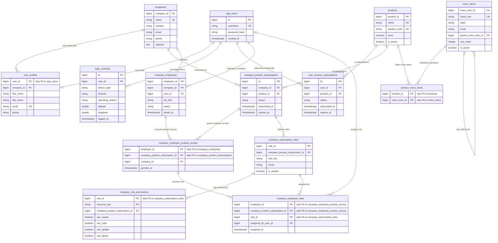

# Data Architecture & Persistence Layer

The PostgreSQL schema defines user and company identity data, individual and company product subscriptions, subscription-scoped employee permissions, and product-driven menu navigation. The diagram shows all 14 persisted tables; the three SQL views are listed below as derived data.

## Entity Model

<!-- mermaid-checked: every attribute is `<type> <name> [<key>] ["<description>"]` with at most one of PK/FK/UK, no \n in descriptions, no {} in descriptions, every relationship label is double-quoted -->

### Derived Views

- `user_available_menu_items` resolves active menu items from an individual user's active product subscriptions.
- `company_employee_available_menu_items` resolves menu items granted through an employee's company product access.
- `company_employee_product_permissions` aggregates the CRUD permissions of an employee's assigned roles by resource.
